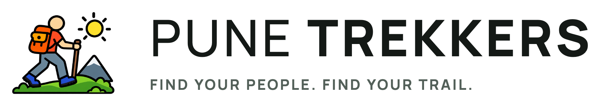
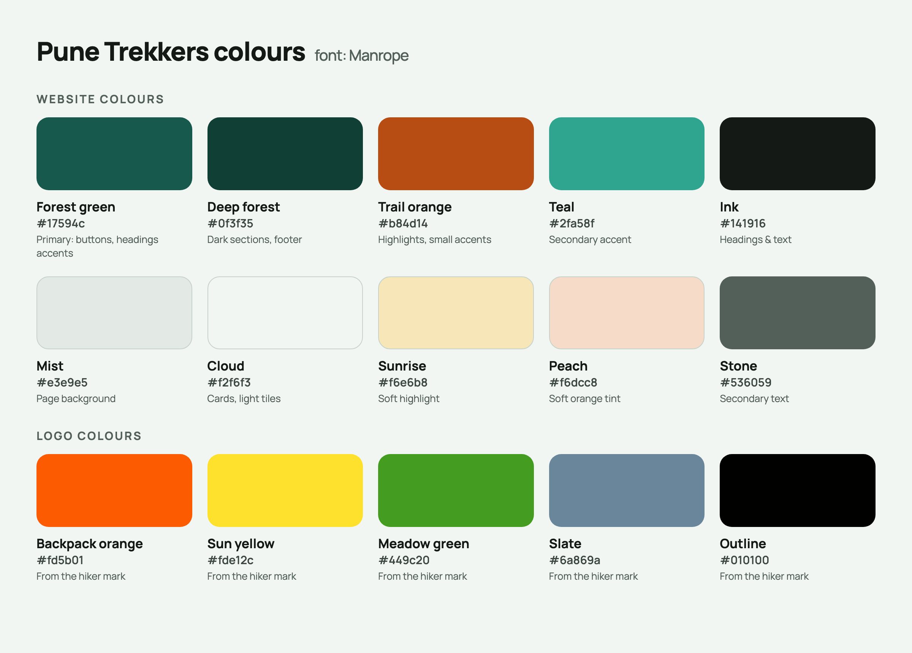

# Pune Trekkers brand kit

Everything organisers need to make posters, posts and profile pictures that look like Pune Trekkers.
Download a file by opening it on GitHub and pressing the download button.



## The basics

| | |
|---|---|
| Name | **Pune Trekkers** (always two words, both capitalised) |
| One-liner | Free, volunteer-run trekking community in Pune |
| Tagline | Find your people. Find your trail. |
| Motto | Community over commerce. |
| Website | [punetrekkers.org](https://punetrekkers.org) |
| Email | hello@punetrekkers.org |
| Instagram | [@punetrekkersofficial](https://www.instagram.com/punetrekkersofficial) |
| Google | [Pune Trekkers on Google Maps](https://maps.google.com/?cid=18151031984770549544) |
| Reviews | [g.page/r/CSiHAP9ra-X7EBM/review](https://g.page/r/CSiHAP9ra-X7EBM/review) |

## Logo

| File | Use it for |
|---|---|
| [`logo/pune-trekkers-mark.png`](logo/pune-trekkers-mark.png) | The hiker on its own. Stickers, small spaces, watermarks |
| [`logo/pune-trekkers-logo-horizontal.png`](logo/pune-trekkers-logo-horizontal.png) | Posters, banners, document headers on light backgrounds |
| [`logo/pune-trekkers-logo-horizontal-white.png`](logo/pune-trekkers-logo-horizontal-white.png) | The same on photos or dark green |
| [`logo/pune-trekkers-logo-stacked.png`](logo/pune-trekkers-logo-stacked.png) | Square spaces: Instagram posts, T-shirts, on light backgrounds |
| [`logo/pune-trekkers-logo-stacked-white.png`](logo/pune-trekkers-logo-stacked-white.png) | The same on photos or dark green |

All logo files have transparent backgrounds.

**Do**
- Leave space around the logo, at least the width of the sun.
- Use the white version on photos and dark backgrounds.
- Keep the hiker's original colours.

**Don't**
- Stretch, rotate, recolour or add shadows and outlines.
- Put the dark version on a busy photo where it can't be read.
- Redraw the wordmark in another font.

## Profile pictures

| File | Use it for |
|---|---|
| [`social/profile-picture-light.png`](social/profile-picture-light.png) | WhatsApp groups, Google Business Profile logo |
| [`social/profile-picture-green.png`](social/profile-picture-green.png) | Alternative with the brand green |
| [`social/profile-picture-black.png`](social/profile-picture-black.png) | Matches the current Instagram picture |
| [`social/link-preview-card.png`](social/link-preview-card.png) | The image shown when punetrekkers.org is shared |

All are 1080 × 1080 px with the hiker centred, so circular crops don't cut it off.

## Colours



| Name | Hex | Use |
|---|---|---|
| Forest green | `#17594C` | Main brand colour: buttons, headings, banners |
| Deep forest | `#0F3F35` | Dark backgrounds |
| Trail orange | `#B84D14` | Small highlights only, never large areas |
| Teal | `#2FA58F` | Secondary accent |
| Ink | `#141916` | Text |
| Mist | `#E3E9E5` | Light backgrounds |
| Cloud | `#F2F6F3` | Cards and light tiles |
| Sunrise | `#F6E6B8` | Soft highlight |

The hiker illustration has its own bright colours (backpack orange `#FD5B01`, sun yellow `#FDE12C`,
meadow green `#449C20`). Keep them in the logo, but use the website colours for everything around it.

## Typography

- **Font:** [Manrope](https://fonts.google.com/specimen/Manrope) (free, from Google Fonts).
- **Headings:** Manrope ExtraBold (800), slightly tight letter spacing.
- **Body text:** Manrope Regular/Medium.
- **Small labels** like `FREE TREKKING GROUP IN PUNE`: Manrope Bold, all capitals, wide letter spacing.
- No Manrope? Use Avenir, or Arial as a last resort.

## How we sound

Friendly, honest and plain. Like a trek buddy, not a travel agency.

| Say | Avoid |
|---|---|
| Free to join, costs shared, no profit | Package, booking fee, offer, discount |
| Trek, hike, trail, community | Tour, trip package, customers |
| Beginners welcome | Easy trek for everyone (be honest about difficulty) |
| Organiser, coordinator, volunteer | Guide (unless they are a qualified guide) |

Always mention, where it fits: **free**, **Pune**, and that **beginners, women and solo trekkers are welcome**.
These are the words people search for.

## Photos

- Real group photos from our treks, not stock images.
- Groups seen from behind, at a distance or against big views work best for public posts.
- Respect no-photo requests, and don't post children without their parents' OK.
- Before uploading to Google, remove location data (Google can use it to move our map pin).
- Original trip photos are kept in the organiser's archive; website copies are in the Archive section of the site.

## Ready-to-use text

**WhatsApp trek announcement**
```
🏔️ [Trek name] · [Day, date]
📍 Meet: [place] at [time]
🥾 Difficulty: [Easy/Moderate/Hard] · [duration]
💰 Cost: ~₹[amount] per person, actual costs shared, no profit
🙋 Beginners welcome. Message [organiser] to join.
Details: punetrekkers.org/treks
```

**Instagram caption**
```
[One line about the moment] 🏔️

[Trek name] with [number] trekkers, many of them first-timers.
Free trekking community in Pune: costs shared, no profit.

Join free 👉 link in bio
#punetrekkers #punetrekking #sahyadri #trekkinginpune #pune
```

**Google Business Profile post**
```
[Trek name], [date]: [one sentence about the day].
Pune Trekkers is a free, volunteer-run trekking community. Beginners welcome.
```
(Add the link `https://punetrekkers.org/join` with the post's button, not in the text.)

**Asking for reviews**
```
If a trek with us helped you find your trail (or your trail buddies), a quick, honest review helps others find a free community instead of paid tours ⭐ https://g.page/r/CSiHAP9ra-X7EBM/review
```
Ask, but never offer anything in return for a review.

---
The website's source files for these assets live in `public/images/brand/`, `public/fonts/` and `styles/base.css`.
